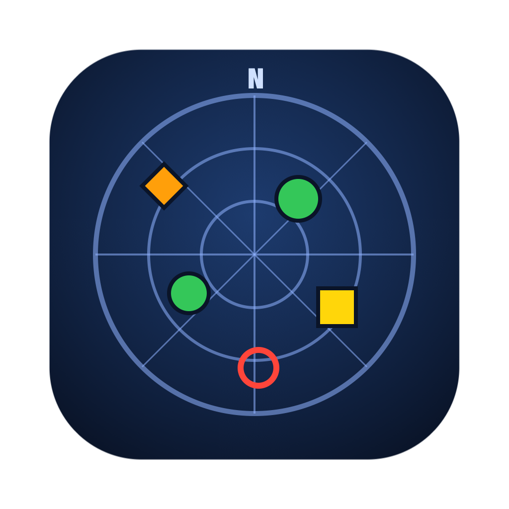
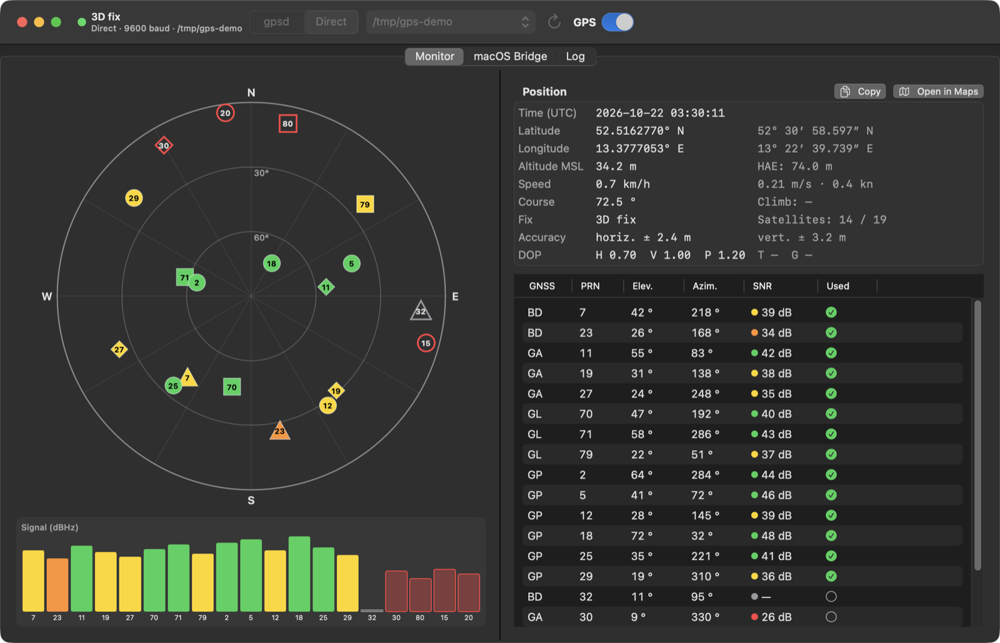
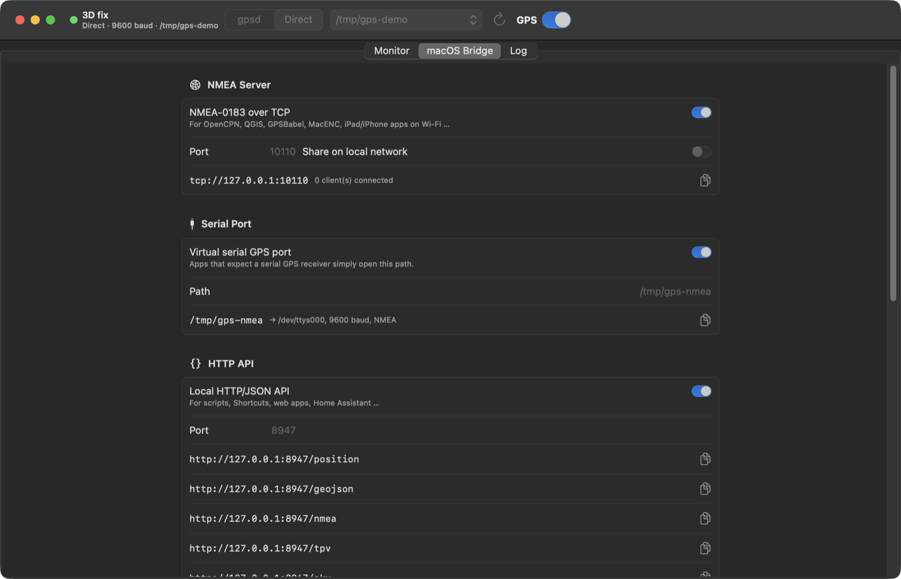
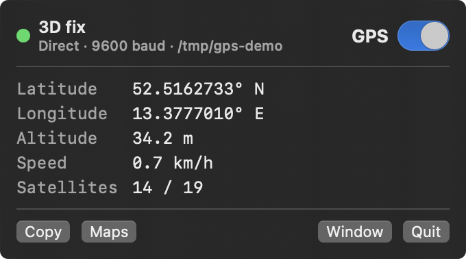
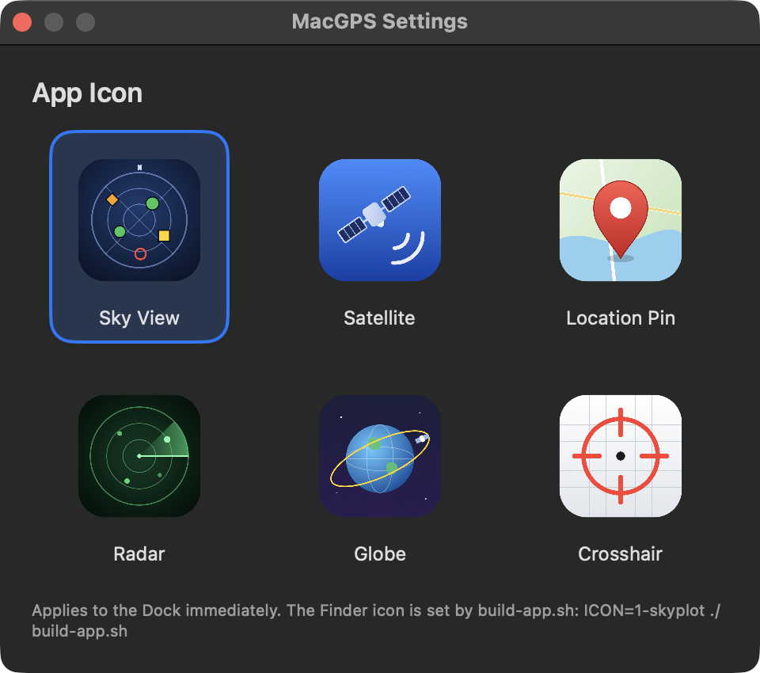
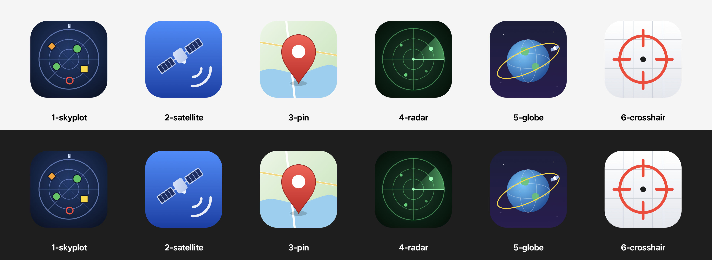

<p align="center">
  
</p>

<h1 align="center">MacGPS</h1>

<p align="center">
  A native macOS GPS monitor in the spirit of <b>xgps</b> – and a bridge that makes your GPS receiver usable by other Mac apps.<br>
  Swift · SwiftUI · works with or without <a href="https://gpsd.io">gpsd</a>
</p>

<p align="center">
  <a href="https://github.com/sigur666/MacGPS/releases/latest/download/MacGPS.dmg"><b>⬇︎ Download MacGPS (.dmg)</b></a>
  &nbsp;·&nbsp;
  <a href="https://github.com/sigur666/MacGPS/releases">All releases</a>
</p>



## What it does

- **Live sky view** – every satellite at its elevation/azimuth, shaped per constellation (GPS ●, GLONASS ■, Galileo ◆, BeiDou ▲), coloured by signal strength, filled when used in the fix.
- **Signal bars and satellite table** – PRN, elevation, azimuth, SNR and "used" state for GPS, GLONASS, Galileo, BeiDou, QZSS, SBAS and NavIC.
- **Position panel** – UTC time, latitude/longitude (decimal and DMS), altitude MSL/HAE, speed, course, climb, fix type, DOP values and **accuracy** (± horizontal / vertical, ~95 %).
- **Two data sources**
  - **gpsd** – connects to a running gpsd, or starts/stops one with the toolbar switch.
  - **Direct** – no gpsd needed: reads an NMEA receiver straight from the serial port, auto-detects the baud rate and follows the receiver when it is re-plugged into another USB port.
- **macOS bridge** – shares the position with other software (see below).
- **Menu bar extra** – position at a glance, on/off switch, copy coordinates, open in Apple Maps.
- **Six app icons** to choose from.
- **`gpsbridge`** – the same bridge as a headless command-line tool.

## Why a bridge?

macOS does not allow third-party apps to feed their own positions into the system-wide Location Services (CoreLocation). MacGPS therefore provides the data through the standard interfaces that Mac programs use for external GPS receivers:

| Interface | Address | Used by, for example |
|---|---|---|
| NMEA-0183 over TCP | `tcp://127.0.0.1:10110` (optionally on the LAN) | OpenCPN, QGIS, GPSBabel, iPad/iPhone navigation apps |
| Virtual serial port | `/tmp/gps-nmea` → `/dev/ttysNNN` | Any program that expects a serial GPS receiver |
| HTTP/JSON API | `http://127.0.0.1:8947/position`, `/geojson`, `/nmea`, `/tpv`, `/sky` | Shortcuts, scripts, web apps, Home Assistant |
| JSON file | `~/Library/Application Support/MacGPS/position.json` | Shell scripts (`jq`) |
| GPX recording | `~/Documents/MacGPS Tracks/` | Track logging |

The NMEA sentences (GGA, RMC, VTG, GSA, GSV) are generated from the decoded data, so with gpsd as the source they also work for receivers that only speak binary protocols (u-blox UBX, SiRF, …).



<p>
  
  
</p>

## Installation

1. **[Download the latest MacGPS.dmg](https://github.com/sigur666/MacGPS/releases/latest/download/MacGPS.dmg)** (or pick a version from [Releases](https://github.com/sigur666/MacGPS/releases)).
2. Open it and drag **MacGPS** into **Applications**.
3. Optional – install the command-line tool from the mounted image:
   ```bash
   sudo cp /Volumes/MacGPS*/"Command Line Tool/gpsbridge" /usr/local/bin/
   ```

The app is ad-hoc signed (no Apple Developer ID). On first launch, right-click MacGPS → **Open**, or run:

```bash
xattr -dr com.apple.quarantine /Applications/MacGPS.app
```

**Requirements:** macOS 14 (Sonoma) or later, Apple Silicon. gpsd is optional (`brew install gpsd`).

## Usage

1. Plug in your GPS receiver and pick it in the toolbar (e.g. `/dev/cu.usbmodem…`).
2. Choose the source: **gpsd** or **Direct**.
3. Flip the switch on. It is off by default when the app starts.
4. Enable the interfaces you need in the **macOS Bridge** tab.

### gpsd or Direct?

| | gpsd | Direct (no gpsd) |
|---|---|---|
| Installation | `brew install gpsd` | nothing |
| Receivers | Everything gpsd supports, incl. binary protocols (u-blox UBX, SiRF, …) | Receivers that output NMEA-0183 (almost all USB/Bluetooth GPS units by default) |
| Baud rate | detected by gpsd | auto-detected (9600, 4800, 38400, 115200, …) or fixed in the *macOS Bridge* tab |
| Several programs at once | via gpsd (port 2947) | via the MacGPS NMEA server / virtual port |

In **gpsd** mode the switch starts `gpsd -N -n -S 2947 <device>` as a child process and stops it again. A gpsd that is already running is detected and shown as "on". A gpsd running as root (`sudo brew services start gpsd`) has to be stopped with `sudo brew services stop gpsd`.

### Accuracy

Shown as ± horizontal / vertical with ~95 % confidence. If the receiver sends GST sentences, its own error estimate is used. Otherwise it is **estimated** as 2 × DOP × UERE (≈ 4 m without correction, 1.5 m with DGPS/SBAS, 0.3 / 0.02 m with RTK float/fixed). Estimates are marked with "≈" in the app and with `"accuracySource": "estimated (DOP × UERE)"` in the JSON/HTTP output.

## gpsbridge (command line)

```bash
gpsbridge --serial /dev/cu.usbmodem1101 --nmea 10110 --http 8947      # without gpsd
gpsbridge --serial /dev/cu.usbserial-110 --baud 4800 --pty /tmp/gps-nmea
gpsbridge --start-gpsd /dev/cu.usbmodem1101 --nmea 10110 --pty /tmp/gps-nmea --http 8947
gpsbridge --once                       # print one position as JSON and exit
gpsbridge --stdout | head              # NMEA on stdout
gpsbridge --gpx ~/Tracks --json ~/pos.json
gpsbridge --help
```

Reading the data:

```bash
curl -s localhost:8947/position | jq '.latitude, .longitude'
nc -d localhost 10110
cat /tmp/gps-nmea
```

## Building from source

```bash
git clone https://github.com/sigur666/MacGPS.git
cd MacGPS
swift test              # unit tests
./build-app.sh          # → dist/MacGPS.app and dist/gpsbridge
./make-dmg.sh           # → dist/MacGPS-<version>.dmg   (VERSION=x.y.z ./make-dmg.sh)
```

The Finder icon is chosen at build time: `ICON=3-pin ./build-app.sh` (default `1-skyplot`). The icon designs live in `Icons/svg/`; `swift Icons/render.swift` regenerates the PNG, `.icns` and `Icons/overview.png`.

### Project layout

| Path | Contents |
|---|---|
| `Sources/GPSCore` | Shared library: gpsd client, gpsd control, NMEA parser and generator, serial reader, TCP/HTTP servers, virtual serial port, GPX logger |
| `Sources/MacGPS` | SwiftUI app |
| `Sources/gpsbridge` | Command-line tool |
| `Tests/GPSCoreTests` | Unit tests (NMEA parsing, checksums, accuracy, serial reader via a pseudo terminal) |
| `Icons` | Icon sources (SVG) and renderer |



## License

[MIT](LICENSE) © 2026 sigur666
